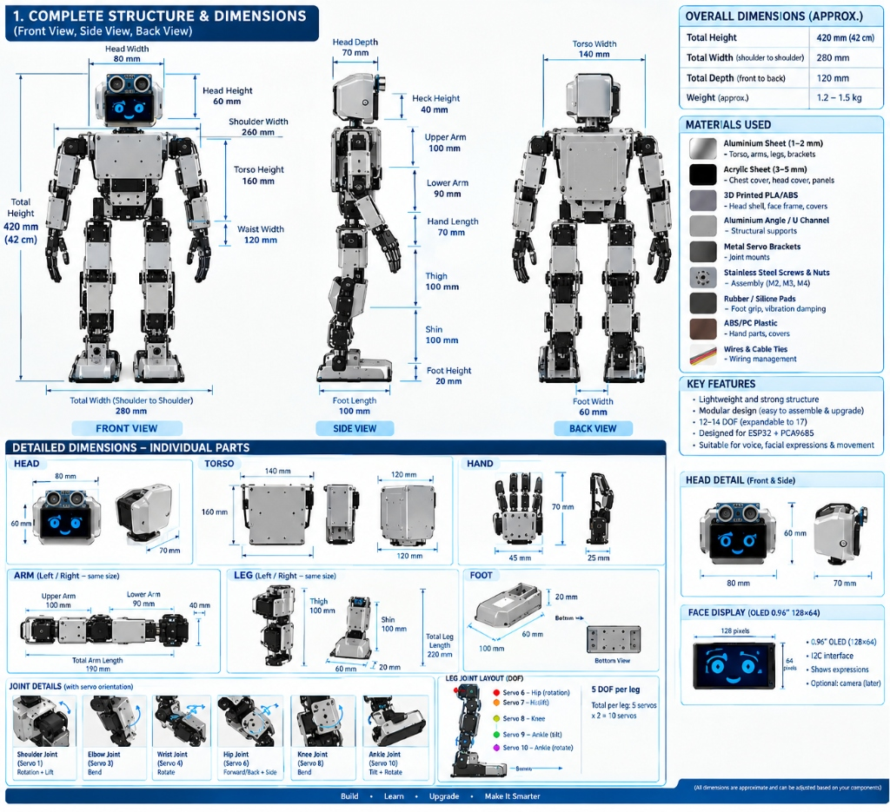
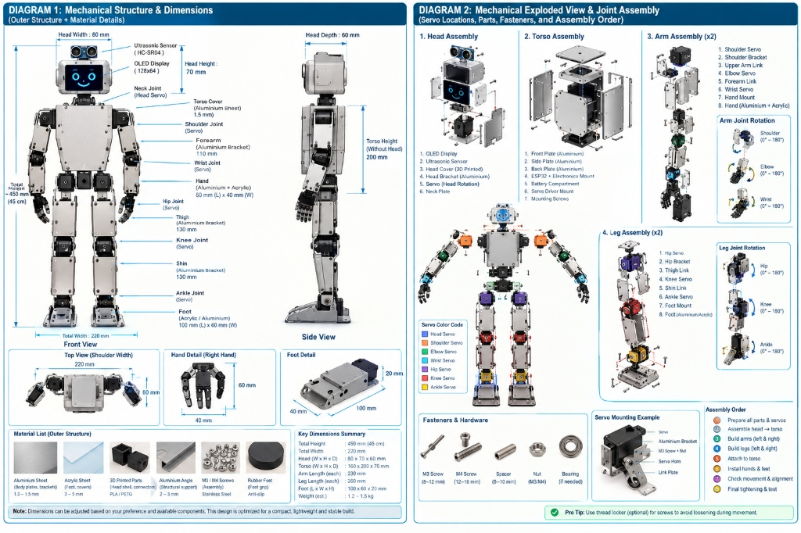
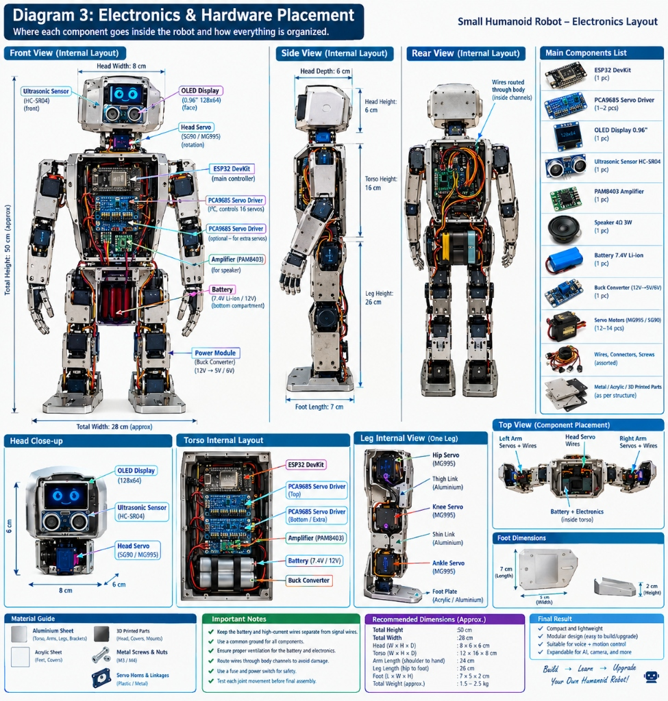
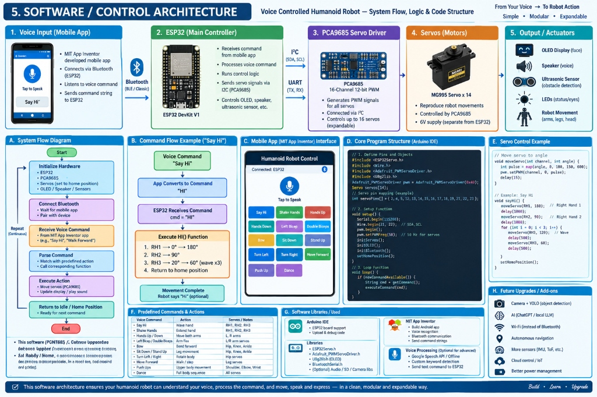
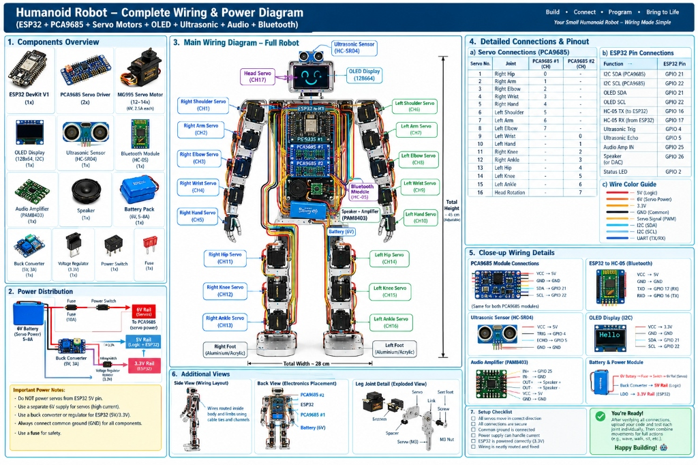

# SimuForge Studio — 17-DOF Humanoid Robot Digital Twin & Simulator

[](https://huggingface.co/spaces/Bedanta12/simuforge-studio)
[](https://rupac4530-creator.github.io/simuforge-studio/)
[](https://react.dev/)
[](https://www.typescriptlang.org/)
[](https://threejs.org/)
[](https://vitejs.dev/)
[](https://tailwindcss.com/)
[](https://opensource.org/licenses/MIT)

| Deployment | Live URL | Platform |
| :--- | :--- | :--- |
| **🤗 Hugging Face Space** | [huggingface.co/spaces/Bedanta12/simuforge-studio](https://huggingface.co/spaces/Bedanta12/simuforge-studio) | Hugging Face Static Space |
| **⚡ Direct Web App** | [bedanta12-simuforge-studio.static.hf.space](https://bedanta12-simuforge-studio.static.hf.space/index.html) | Hugging Face CDN |
| **🌐 GitHub Pages** | [rupac4530-creator.github.io/simuforge-studio](https://rupac4530-creator.github.io/simuforge-studio/) | GitHub Actions Automated Pages |

**SimuForge Studio** is an open-source, browser-native 3D robotics simulator, kinematic testbed, and digital twin engineered specifically for the **17-DOF Hash V3 Humanoid Robot**.

Built with React 18, Three.js / React Three Fiber, Monaco Editor, and Web Speech API, SimuForge Studio provides a professional Webots-style environment to simulate forward kinematics, bipedal locomotion gaits, obstacle RF signal attenuation, virtual smartphone remote operations, and sandboxed microcontroller firmware routines.

---

## 🌟 Key Capabilities

- **17-DOF Real-Time Kinematics & Physics Engine**: Forward kinematics calculation for all 17 servo joints (10 leg joints, 6 arm joints, 1 head yaw joint) with real-world dimensions (420–450 mm height, 280 mm width, 1.2–1.5 kg estimated mass).
- **Interactive Semi-Transparent Chassis**: Inspect internal packaging—ESP32 DevKit, dual PCA9685 PWM drivers, 2S Li-ion battery pack, buck converters, I2S amplifier, speaker, and structural harnesses.
- **Virtual Smartphone Remote (BLE Emulation)**:
  - **Live Voice Recognition**: Uses the Web Speech API (`webkitSpeechRecognition`) to process natural speech commands directly in the browser.
  - **16 Pre-Programmed Gestures & Gaits**: One-tap triggers for *Say Hi*, *Shake Hands*, *Hands Up/Down*, *Bicep Flexes*, *Bow*, *Sit Down*, *Stand Up*, *Forward Walk*, *Backward Walk*, *Turn Left/Right*, *Push-Ups*, and *Celebration Dance*.
  - **D-Pad Locomotion**: Precise walking and turning control with instant visual feedback and world translation.
  - **Live Telemetry & Safety**: Battery voltage percentage indicator, BLE RSSI link monitor, ARM/DISARM motor toggle, and immediate Emergency Stop (E-Stop).
- **Hardware Inspector & Diagnostic Suite**:
  - **Component Directory**: Live status, bus addressing, and power ratings for all internal modules.
  - **Servo Stress & Load Monitor**: Real-time angular deviation and torque stress calculation with thermal overload warnings.
  - **Battery Energy Profile**: Dynamic 2S Li-ion discharge curve, current draw calculation (quiescent logic + active servo load), and runtime estimation.
  - **SSD1306 OLED Display Preview**: Interactive face expression emulator (*Happy*, *Sad*, *Angry*, *Blink*, *Surprise*, *Sleep*, *Love*, *Cool*).
  - **Ultrasonic Distance Radar**: Real-time HC-SR04 obstacle detection against arena barriers (Concrete, Brick, Glass, Metal).
- **Integrated Monaco Code Studio**:
  - Sandboxed JavaScript runtime with full robot control API (`robot.setServo`, `robot.homePosition`, `robot.wait`, `robot.log`).
  - Pre-loaded gait and routine templates with step-by-step telemetry logging.
  - Automatic template synchronization when voice commands or phone remote buttons are triggered.
- **RF Signal Propagation & Link Budget Analyzer**:
  - Multi-band propagation model: 2.4 GHz BLE, 2.4 GHz Wi-Fi, 915 MHz LoRa, 5.8 GHz FPV.
  - Dynamic path loss, antenna gain (Tx/Rx), noise figure, real-time RSSI/SNR oscilloscope, and physical obstacle wall penetration loss.

---

## 📐 Engineering Diagrams & Hardware Documentation

The simulator's kinematic model, electronic interfaces, and structural dimensions are derived directly from the physical humanoid robot build documentation:

### 1. Structural Dimensions & Physical Specifications


* **Overall Dimensions**: 420 mm standing height (expandable to 450 mm), 280 mm shoulder-to-shoulder width, 120 mm front-to-back depth, with an assembled weight of 1.2–1.5 kg.
* **Materials & Chassis**: Cut and bent 1.0–2.0 mm lightweight aluminum alloy sheet for torso and limb linkages, 3.0–5.0 mm laser-cut acrylic chest and head covers, 3D printed PLA/ABS head frame, aluminum U-channels, and silicone anti-vibration foot soles.
* **Kinematic Degrees of Freedom (17-DOF)**:
  * **Legs (5 DOF × 2 = 10 DOF)**: Hip Yaw, Hip Roll, Hip Pitch, Knee Pitch, Ankle Pitch.
  * **Arms (3 DOF × 2 = 6 DOF)**: Shoulder Pitch, Shoulder Roll, Elbow Pitch.
  * **Head (1 DOF)**: Neck Yaw rotation.
* **Head & Facial Unit**: Integrates a 0.96" SSD1306 OLED screen (128×64 pixels) for animated facial expressions and dual HC-SR04 ultrasonic transducers for obstacle awareness.

---

### 2. Mechanical Exploded View & Joint Assembly


* **Sub-Assembly Breakdown**:
  * **Head Assembly**: Front faceplate, OLED display bracket, ultrasonic sensor mounting cradle, 3D printed rear enclosure, and pan servo bracket.
  * **Torso Enclosure**: Heavy-duty structural aluminum frame with front, back, and side plates enclosing the electronics bay, battery compartment, and dual servo driver stack.
  * **Arm Assemblies (x2)**: Shoulder pitch bracket, upper arm U-channel link (100 mm), elbow pitch servo, forearm bracket (90 mm), and passive multi-jointed gripping hand (70 mm).
  * **Leg Assemblies (x2)**: Pelvis mounting bracket, hip rotation joint, thigh link (100 mm), knee bend joint, shin link (100 mm), ankle pivot, and broad aluminum foot plate (100 × 60 × 20 mm).
* **Hardware & Fasteners**: High-tensile M3 (8–12 mm) and M4 (12–16 mm) stainless steel hex-socket machine screws, aluminum standoffs/spacers, flange bearings, and nylon locknuts.
* **Assembly Workflow**: Follows an 8-stage pipeline from individual servo electrical zeroing (90° neutral calibration), sub-chassis assembly, harness routing, to final center-of-mass alignment.

---

### 3. Internal Electronics & Hardware Placement


* **Torso Interior Layout**:
  * **Primary Controller**: ESP32 DevKit V1 (Xtensa dual-core @ 240 MHz, integrated BLE 4.2 & 802.11 b/g/n Wi-Fi) mounted in the upper torso.
  * **Servo Driver Stack**: Dual PCA9685 16-channel 12-bit PWM controllers communicating over I²C (`0x40` primary, `0x41` auxiliary).
  * **Audio Subsystem**: PAM8403 / MAX98357A audio amplifier paired with a 4Ω 3W dynamic speaker located behind the upper chest vent.
  * **Power Bay**: Low-center-of-mass bottom compartment housing the 2S 7.4V Li-ion battery pack and high-efficiency switching buck converters.
* **Wiring Channels**: Recessed internal raceways protect servo signal lines (PWM), I²C buses, and high-current power cables from pinching during multi-axis articulation.

---

### 4. Software & Control System Architecture


* **Communication Pipeline**:
  $$\text{Voice / Smartphone UI} \xrightarrow{\text{BLE / Web Speech}} \text{ESP32 DevKit} \xrightarrow{\text{I²C Bus}} \text{Dual PCA9685} \xrightarrow{\text{50 Hz PWM}} \text{17× Servos}$$
* **System Flow & State Machine**:
  * Non-blocking command dispatcher parses incoming Bluetooth/serial strings.
  * Forward kinematics trajectory generator computes smoothstep joint interpolation curves.
  * Synchronized multi-modal feedback triggers matching OLED facial bitmaps and audio playback via I²S DAC.
* **Extensible Firmware**: Designed for seamless transition from the browser simulator to physical C++/Arduino IDE firmware (`Adafruit_PWMServoDriver`, `Wire`, `ESP32Servo`, `U8g2lib`).

---

### 5. Wiring Schematic & Power Distribution


* **Dual-Rail Power Architecture**:
  * **High-Current Servo Rail**: 2S 7.4V Li-ion $\rightarrow$ 10A Master Fuse $\rightarrow$ Toggle Switch $\rightarrow$ 6V 5A UBEC $\rightarrow$ PCA9685 V+ terminals. Prevents motor back-EMF and inductive current spikes from resetting the controller.
  * **Logic Rail**: 7.4V $\rightarrow$ 5V 3A Buck Converter $\rightarrow$ ESP32 VIN, logic VCC for PCA9685 drivers, OLED display, and audio amplifier.
  * **Sensor Rail**: 3.3V regulated output from ESP32 for low-noise sensor references.
* **Pinout & Bus Topology**:
  * **I²C Bus**: SDA (GPIO 21), SCL (GPIO 22) operating at 400 kHz fast mode, shared by PCA9685 #1 (`0x40`), PCA9685 #2 (`0x41`), and SSD1306 OLED (`0x3C`).
  * **Ultrasonic (HC-SR04)**: Trigger $\rightarrow$ GPIO 12, Echo $\rightarrow$ GPIO 14 (with 5V-to-3.3V voltage divider).
  * **I²S Audio DAC**: BCLK $\rightarrow$ GPIO 26, LRC $\rightarrow$ GPIO 25, DOUT $\rightarrow$ GPIO 27.
  * **Status Telemetry**: Onboard Heartbeat LED $\rightarrow$ GPIO 2.

---

## 💻 Tech Stack

| Category | Technologies |
| :--- | :--- |
| **Frontend Core** | React 18, TypeScript 5.6, Vite 6 |
| **3D Rendering** | Three.js (r170), `@react-three/fiber`, `@react-three/drei` |
| **Code Editor** | Monaco Editor (`@monaco-editor/react`) |
| **Charts & Signals**| Recharts 2.13 |
| **Styling & UI** | TailwindCSS 3.4, Lucide React Icons |
| **Voice Recognition**| HTML5 Web Speech API |

---

## 🚀 Quick Start (Local Development)

### Prerequisites

Ensure you have **Node.js 18+** and **pnpm** (or npm / yarn) installed:

```bash
node -v
pnpm -v
```

### Installation

1. Clone the repository:
   ```bash
   git clone https://github.com/rupac4530-creator/simuforge-studio.git
   cd simuforge-studio
   ```

2. Install dependencies:
   ```bash
   pnpm install
   ```

3. Start the development server:
   ```bash
   pnpm run dev
   ```

4. Open your browser at:
   ```
   http://localhost:5173
   ```

### Production Build

To verify TypeScript typing and create an optimized production build:

```bash
pnpm run build
```

The compiled static assets will be output to the `dist/` directory ready for deployment to any static hosting provider (GitHub Pages, Vercel, Netlify, Cloudflare Pages).

---

## 📁 Repository Structure

```
simuforge-studio/
├── docs/
│   └── diagrams/                     # High-resolution robot blueprints & schematics
│       ├── 01-complete-structure-and-dimensions.jpg
│       ├── 02-mechanical-assembly-and-exploded-view.jpg
│       ├── 03-internal-electronics-hardware-layout.jpg
│       ├── 04-software-and-control-architecture.jpg
│       └── 05-wiring-and-power-distribution-diagram.jpg
├── public/                           # Static assets & icons
├── src/
│   ├── components/
│   │   ├── CameraControlHUD.tsx       # Orbit, top, chase, side, FPV camera presets
│   │   ├── CodeSpaceIDE.tsx           # Monaco code editor with ESP32 sandboxed runtime
│   │   ├── HardwareInspectorPanel.tsx # 6-tab modal for diagnostic telemetry
│   │   ├── HumanoidModel.tsx          # 17-DOF articulated 3D mesh with semi-transparent torso
│   │   ├── PhoneRemoteHUD.tsx         # Virtual mobile remote with Web Speech & D-pad
│   │   ├── SceneTreePanel.tsx         # Webots-style hierarchical scene & servo inspector
│   │   ├── SignalAnalyzerPanel.tsx    # RF link propagation & oscilloscope panel
│   │   ├── TopControlBar.tsx          # Simulation transport, speed, and status bar
│   │   └── Viewport3D.tsx             # Three.js Canvas, shadow maps, lighting, arena
│   ├── engine/
│   │   ├── HumanoidKinematics.ts      # 17-DOF forward kinematics & gait animator
│   │   └── SignalEngine.ts            # RF propagation & multi-layer wall loss calculator
│   ├── types/
│   │   └── simulation.ts              # Master TypeScript interfaces, PCA map & constants
│   ├── App.tsx                        # Root application orchestrator
│   ├── index.css                      # Global styles & custom scrollbars
│   └── main.tsx                       # React DOM entry point
├── index.html
├── package.json
├── postcss.config.js
├── tailwind.config.js
├── tsconfig.json
└── vite.config.ts
```

---

## 🛠️ Usage Guide

1. **Walking & Turning**:
   * Open the **Phone Remote** (bottom-right button) $\rightarrow$ select the **🕹️ LOCOMOTION** tab $\rightarrow$ tap the Arrow buttons to command forward/backward walking and left/right turns.
   * Alternatively, select *Move Forward* or *Turn Left* from the top **Voice Cmd** dropdown.
2. **Natural Voice Control**:
   * Open the Phone Remote $\rightarrow$ tap **🎤 TAP TO SPEAK** $\rightarrow$ say commands like *"Say Hi"*, *"Move Forward"*, *"Turn Left"*, *"Dance"*, or *"Sit Down"*.
3. **Inspecting Internal Electronics**:
   * Orbit the camera around the robot or zoom into the chest. The outer aluminum shell is rendered semi-transparent (35% opacity), revealing the green ESP32 board, dual blue PCA9685 boards, Li-ion battery, BECs, and color-coded bus wiring.
   * Click the **🔧 HARDWARE INSPECTOR** button (bottom-left) to view live component specifications, servo stress gauges, battery telemetry, OLED expressions, and ultrasonic obstacle radar.
4. **Writing Custom Scripts**:
   * Expand the **Controller Code Space** at the bottom of the screen. Select a template or write custom asynchronous JavaScript using the exposed `robot` object:
     ```javascript
     async function customWave() {
       robot.log("Starting custom wave...");
       robot.setServo("R_Shoulder_Pitch", 180);
       await robot.wait(500);
       robot.setServo("R_Elbow_Pitch", 60);
       await robot.wait(300);
       robot.setServo("R_Elbow_Pitch", 120);
       await robot.wait(300);
       robot.homePosition();
     }
     customWave();
     ```
   * Click **RUN SCRIPT** to execute in the physics engine.

---

## 📄 License

This project is open-source under the [MIT License](LICENSE).

Developed with ❤️ by **[BEDANTA CHATTERJEE](https://github.com/rupac4530-creator)** ([@Bedanta12 on Hugging Face](https://huggingface.co/Bedanta12)).
