# SimuForge Studio — 180 cm Biomimetic Humanoid Twin & Multi-Physics Simulator

[](https://huggingface.co/spaces/Bedanta12/simuforge-studio)
[](https://rupac4530-creator.github.io/simuforge-studio/)
[](https://react.dev/)
[](https://www.typescriptlang.org/)
[](https://threejs.org/)
[](https://vitejs.dev/)
[](https://tailwindcss.com/)
[](https://opensource.org/licenses/MIT)

| Deployment | Live URL | Platform |
| :--- | :--- | :--- |
| **🤗 Hugging Face Space** | [huggingface.co/spaces/Bedanta12/simuforge-studio](https://huggingface.co/spaces/Bedanta12/simuforge-studio) | Hugging Face Static Space |
| **⚡ Direct Web App** | [bedanta12-simuforge-studio.static.hf.space](https://bedanta12-simuforge-studio.static.hf.space/index.html) | Hugging Face CDN |
| **🌐 GitHub Pages** | [rupac4530-creator.github.io/simuforge-studio](https://rupac4530-creator.github.io/simuforge-studio/) | GitHub Actions Automated Pages |
| **💻 Source Code** | [github.com/rupac4530-creator/simuforge-studio](https://github.com/rupac4530-creator/simuforge-studio) | GitHub Repository |
| **📄 Engineering Blueprint** | [docs/BIOMIMETIC_HUMANOID_BLUEPRINT.md](docs/BIOMIMETIC_HUMANOID_BLUEPRINT.md) | Exhaustive Multi-Physics Blueprint |

---

## 🌟 Overview: Flagship 180 cm Biomimetic Humanoid Digital Twin

**SimuForge Studio** is an open-source, browser-native 3D robotics simulation platform, rigid-body multi-physics testbed, and digital twin environment dedicated exclusively to this **180 cm Biomimetic Humanoid Engineering Project** (68.4 kg, 110+ Degrees of Freedom, 4 Concentric Anatomical Layers).

Inspired by state-of-the-art global humanoid robotics:
- **Engineered Arts *Ameca*** (cranial Bowden cable actuation, subtle silicone facial expression & micro-wrinkles)
- **Hanson Robotics *Sophia*** (porous elastomeric dermal mechanics, anchor pegs, and lifelike skin compliance)
- **Clone Robotics & JSK University of Tokyo *Kenshiro / Kengoro*** (full-body musculoskeletal McKibben hydro-muscles, articulated 24-vertebrae spine, and vascular liquid cooling network)
- **Disney Research Animatronics** (high-speed gaze vergence saccades and coupled eyelid kinematics)
- **Tesla *Optimus Gen 2* & Figure AI *Figure 02*** (high-torque Quasi-Direct Drive lower-body actuators, planetary roller screws, 1000 Hz EtherCAT ring, and 16S 58.8V 2.4kWh structural battery core).

---

## 🔬 SOTA Biomimetic Humanoid Foundations

SimuForge Studio was architected by dissecting the core engineering accomplishments of the world's most advanced humanoid platforms:

| Robot System | Height / Weight | Facial DoF & Dermis | Actuation Architecture | Vision & Gaze | Primary Engineering Lesson |
| :--- | :--- | :--- | :--- | :--- | :--- |
| **Engineered Arts Ameca** | 187 cm / 72 kg | 27 cranial DoF; proprietary silicone; motorized lips/brows | Coreless linear/rotary servos; Bowden neck linkage | Binocular cameras in 24mm eyeballs; independent vergence | Decouple cranial motors into clavicle/torso; route via Bowden cables |
| **Hanson Robotics Sophia** | ~168 cm / 45 kg (bust) | 36+ cranial DoF; patented **Frubber** elastomer | Sub-micro servomotors pulling skin via anchor pegs | Eye cameras behind pupil apertures; face tracking | Frubber porous matrix drastically reduces servo stall compared to dense silicones |
| **JSK Kengoro / Kenshiro** | 167 cm / 54 kg | Skeletal head; zero facial skin | **116 McKibben artificial hydro-muscles**; redundant tendon routing | Stereo vision in head; IMU spine balance | Musculoskeletal hydro-muscles provide biological compliance and shock absorption |
| **Disney Research Animatronics** | 175 cm / 65 kg | 19 facial DoF; multi-layer soft silicone with embedded anchors | Hybrid pneumatic-electric actuation with custom 4-bar linkages | High-speed gaze saccades (up to 400°/s) with eyelid-gaze coordination | Saccade motion blur vs global shutter in camera sensors |
| **Tesla Optimus Gen 2** | 173 cm / 57 kg | Screen visor (no expressive face); monolithic aesthetic | Custom planetary QDD (up to 180 Nm) + linear roller screws | Monocular/stereo RGB + pure vision Occupancy Network | High-efficiency 52V/48V power distribution and custom structural castings |
| **Figure AI Figure 02** | 178 cm / 70 kg | Face visor; integrated audio array | Custom rotary QDD + linear actuators; 16-DoF hands | 6 onboard RGB cameras, vision-language-action (VLA) AI | Integrated compute routing; cable-free limb bus architecture |

<div align="center">
  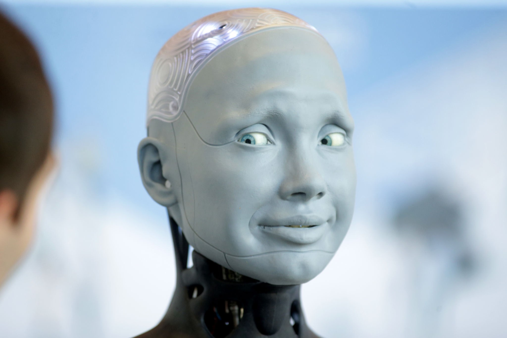
  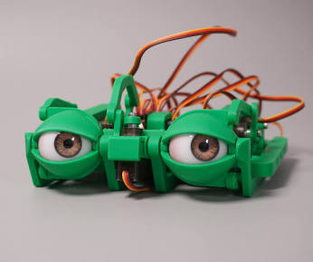
  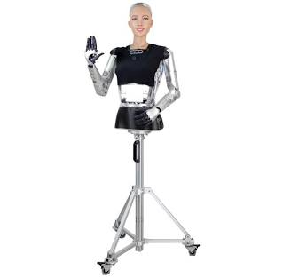
  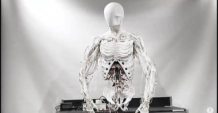
</div>

---

## 🧬 4 Concentric Anatomical Layers with Live X-Ray Dissection

SimuForge Studio introduces a **4-Layer Concentric Anatomical Architecture** with independent opacity sliders ($0.0 \rightarrow 1.0$) and smart raycast picking:

```
[Layer 1: Integumentary / Silicone Dermis]   --> Opacity 0.0 to 1.0 (SSS PBR, Hair, Taxels)
       │
[Layer 2: Musculoskeletal / Actuators]       --> Opacity 0.0 to 1.0 (Hydro-Muscles, Bowden FACS, QDD)
       │
[Layer 3: Endoskeleton / Vascularity]        --> Opacity 0.0 to 1.0 (Carbon/7075-T6 Bones, Cooling Capillaries)
       │
[Layer 4: Bionic Eyeballs, Compute & Core]   --> Opacity 0.0 to 1.0 (24mm Eyes, Iris, MIPI PCB, Orin Brain, 16S Pack)
```

1. **Layer 1: Integumentary & Dermal System**:
   - Translucent silicone dermis with Subsurface Scattering (SSS) PBR shader.
   - Formulations: `Smooth-On Ecoflex 00-10`, `Ecoflex 00-20`, `Frubber`, `Smooth-On Dragon Skin 10`.
   - Instanced 3D hair follicles for eyebrows, eyelashes, and hairline punched at physiological angles ($15^\circ$–$45^\circ$).
   - Sub-dermal resistive e-Skin heating matrix maintaining $32^\circ\text{C}$–$36^\circ\text{C}$ surface warmth.
2. **Layer 2: Musculoskeletal & Actuation System**:
   - **32-DoF Cranial FACS Rig**: Bowden cable paths routing from clavicle/cervical servos to facial anchor pegs. Standardized Action Units (AUs): AU1, AU2, AU4, AU5, AU6, AU9, AU12 (Duchenne Smile), AU15, AU20, AU25, AU26 (Jaw Drop), AU45 (Blink).
   - **Upper-Body McKibben Hydro-Muscles**: Braided artificial hydro-muscles driving shoulder complex, biceps, triceps, and 24-DoF anthropomorphic hands.
   - **Lower-Body High-Torque QDD Actuators**: Frameless PMSM motors with 6:1/8:1 planetary gearboxes (180–360 Nm) and planetary roller-screw linear actuators in thighs/calves (up to 8,000 N).
3. **Layer 3: Endoskeleton & Thermal Vascularity**:
   - **CNC 7075-T6 Anodized Aluminum** core with structural carbon-fiber shells.
   - **Articulated 24-Vertebrae Spine** with elastomeric intervertebral damping discs.
   - **Closed-Loop Liquid Cooling Network**: Micro-capillary fluid conduits routing deionized water + 15% propylene glycol from thoracic compute and hip motors through radiator exhausts.
4. **Layer 4: Internal Micro-Electronics & Bionic Eyeballs**:
   - **24 mm Hollow Spherical Eyeball Assemblies** on 6-DoF dual-eye gimbal:
     - Independent left/right yaw ($\pm 35^\circ$) for binocular vergence.
     - Coupled pitch ($\pm 30^\circ$) for gaze elevation.
     - Coordinated upper/lower eyelids ($\pm 45^\circ$).
     - Actuated 6-blade Nitinol SMA iris dynamically adjusting pupil aperture between **2.0 mm** and **7.0 mm**.
     - 8×8 mm micro-camera PCB mounted behind pupil with MIPI CSI-2 flex ribbon.
   - **Thoracic Compute & Power Core**:
     - Cerebrum: Dual NVIDIA Jetson Thor/Orin AI modules.
     - Cerebellum: TI TMS320F28388D C2000 real-time EtherCAT microcontrollers.
     - Battery: 16S 58.8V nominal NMC 21700 or Silicon-Anode 4680 cell pack (1.8–2.4 kWh).

---

## ⚡ Live Modular Hot-Swapping Engine (`ComponentRegistry`)

Every component in SimuForge Studio is hot-swappable in real time via the **Live Module Editor Panel**:

| Component Category | Swappable Hardware Options | Technical Specifications & Consequence Impact |
| :--- | :--- | :--- |
| **Eyeball Camera** | **Sony IMX219 (8MP)** | 3280×2464, 60 FPS, Rolling Shutter; 180 mW; visible skew during fast saccades. |
| | **OmniVision OV9281 (1MP)** | 1280×800, 120 FPS, **Global Shutter**; 140 mW; zero motion blur, ultra-fast SLAM. |
| | **OmniVision OV5640 (5MP)** | 2592×1944, 90 FPS, Auto-Focus VCM; 220 mW; micro lens barrel, vivid color. |
| | **Prophesee Gen4.1 Neuromorphic** | 1280×720, 10,000+ FPS equiv, 120 dB dynamic range, 50 mW; microsecond event stream. |
| **Dermal Silicone** | **Smooth-On Ecoflex 00-10** | Shore 00-10, Modulus $0.05\text{ MPa}$, 800% elongation; ultra-soft, low torque. |
| | **Smooth-On Ecoflex 00-20** | Shore 00-20, Modulus $0.08\text{ MPa}$; balanced compliance, standard skin. |
| | **Nanoporous Frubber** | Porous elastomer, Modulus $0.03\text{ MPa}$; **40% lower servo load**, micro-wrinkle fidelity. |
| | **Smooth-On Dragon Skin 10** | Shore 10A, Modulus $0.59\text{ MPa}$ ($11.8\times$ stiffer); **triggers cranial servo stall warnings**. |
| **Cranial Actuator** | **Sub-Micro PWM Servos** | 0.28 Nm peak torque, 9g weight; budget baseline. |
| | **Coreless Linear Micro-Servos**| Faulhaber 0615 + micro lead screw, 15N force, 0.02mm resolution, zero backlash. |
| **Battery Core** | **16S NMC 21700 (1.8 kWh)** | Samsung 50G, 58.8V nom, 30Ah, 11.2 kg, 3.5 hr runtime. |
| | **16S Silicon-Anode 4680 (2.4 kWh)** | Amprius / 4680, 60V, 40Ah, 9.8 kg, **5.2 hr runtime**, 1.4 kg lighter. |

---

## 🧮 Multi-Physics Consequence Models

### 1. Ocular Optics & Iris Dilation
The effective focal ratio ($f$-number) $N$ is governed by focal length $f$ and pupil aperture diameter $D$:
$$N = \frac{f}{D}, \quad D \in [2.0\text{ mm}, 7.0\text{ mm}]$$
Dilating the pupil from 2.0 mm to 7.0 mm produces:
$$\Delta \text{Throughput} = \left(\frac{7.0}{2.0}\right)^2 = 12.25\times \quad (+3.61\text{ EV})$$
Binocular stereoscopic vergence angle $\theta_v$ for inter-pupillary distance $IPD = 64\text{ mm}$:
$$\theta_{\text{vergence}} = 2 \arctan\left(\frac{IPD / 2}{d_{\text{target}}}\right) = 2 \arctan\left(\frac{0.032}{d_{\text{target}}}\right)$$

### 2. Silicone Elasticity & Servo Stall Warnings
Force required to deform the facial elastomer:
$$F_{\text{cable}} = E_{\text{silicone}} \cdot A_{\text{anchor}} \cdot \epsilon + \mu \frac{d\epsilon}{dt}, \quad \tau_{\text{servo}} = F_{\text{cable}} \cdot r_{\text{pulley}}$$
Selecting stiff elastomers (`Dragon Skin 10`, $E = 0.59\text{ MPa}$) during a Duchenne smile ($AU12$) causes $\tau_{\text{servo}} > \tau_{\text{stall}}$, immediately triggering red servo stall alerts and mechanical strain heatmaps.

### 3. Thermal Equilibrium & Coolant Convection
Core and skull temperature cascade:
$$C_{\text{thermal}} \frac{dT_{\text{core}}}{dt} = P_{\text{heat}} - \dot{m} c_p (T_{\text{out}} - T_{\text{in}}) - \dot{Q}_{\text{exhaust}} - \dot{Q}_{\text{skin\_loss}}$$

---

## 🎮 Interactive UI Panels & Viewports

- **Floating Layer HUD (`LayerControlBar.tsx`)**: Individual opacity sliders for Integumentary, Musculoskeletal, Endoskeleton, and Electronics, with X-Ray Dissection Mode and preset shortcuts (*Full Anatomical*, *Skeletal*, *Muscular*, *Eyeball Dive*).
- **Synthetic "Robot Eye View" PiP Viewport (`RobotEyePiPViewport.tsx`)**: Floating viewport rendering the world from inside the 24 mm eyeball pupil. Dynamically simulates:
  - Aperture exposure gain & depth-of-field blur.
  - Rolling shutter wobble skew during fast saccades vs crisp Global Shutter frames.
  - Neuromorphic temporal contrast event display.
  - Depth map projection & SLAM latency telemetry.
- **Facial Expression & Lip-Sync Studio (`FacialExpressionStudio.tsx`)**:
  - FACS Action Unit sliders for brows, eyes, nose, cheeks, and mouth.
  - Audio2Face phoneme lip-sync presets (`A`, `E`, `I`, `O`, `U`, `B_P_M`, `L_T`, `F_V`).
  - Emotion presets: *Neutral*, *Joy / Smile*, *Surprise*, *Anger*, *Suspicion*, *Sorrow*.
  - Live cable tension gauges and servo overload telemetry.
- **Logarithmic Depth Micro-Zoom**:
  - Three.js WebGLRenderer configured with `logarithmicDepthBuffer: true`, near plane `0.0005 m` (0.5 mm), and far plane `50.0 m`.
  - Zero Z-fighting or near-plane clipping when zooming from 1.8 meters down into the 24 mm eyeball socket.

---

## 📸 High-Resolution System Photo Gallery (10 Architectural Features)

| # | System Architecture & Viewport | Preview |
| :---: | :--- | :---: |
| **01** | **180 cm Biomimetic Humanoid Twin (Full Clone)**<br>Full anatomical 1.8 m humanoid with Subsurface Scattering silicone dermis, instanced eyebrows/eyelashes, 4-layer HUD, and synthetic PiP ocular camera. | 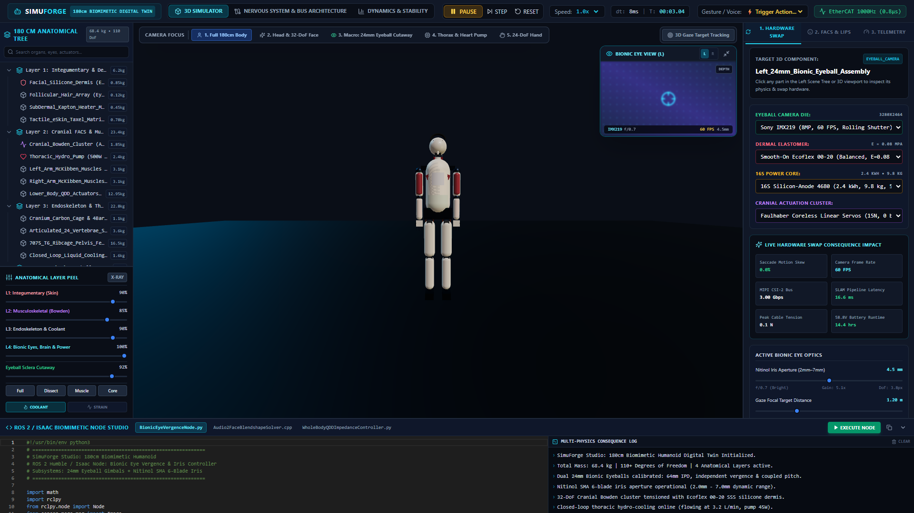 |
| **02** | **Anatomical X-Ray Dissection Mode**<br>Skin peeled to 15% opacity revealing the internal CNC 7075-T6 aluminum skeleton, articulated 24-vertebrae spine, and deionized liquid cooling loops (cyan supply, red return). | 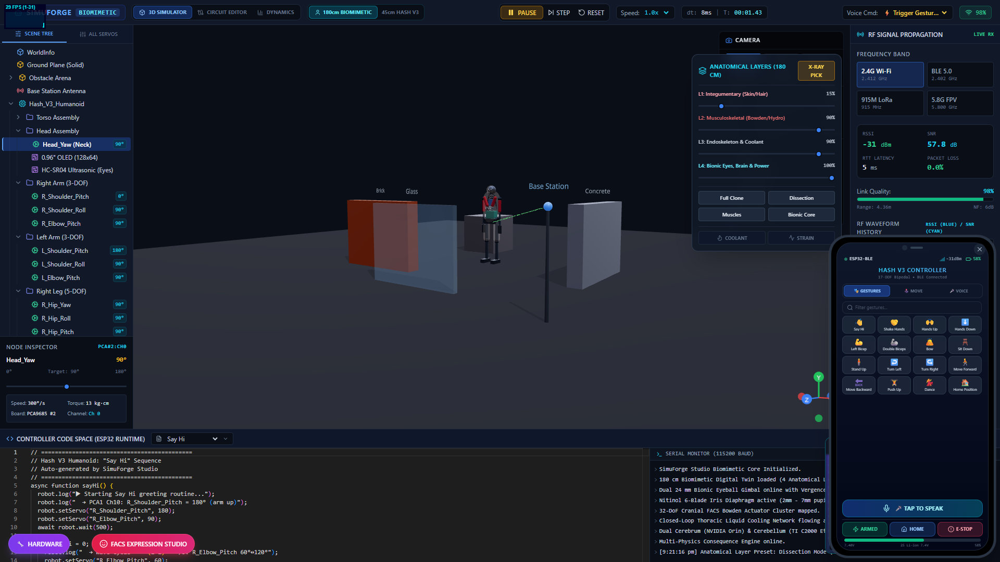 |
| **03** | **Musculoskeletal Hydro-Muscles & Tendon Rig**<br>Skin hidden to isolate the 32 cranial Bowden micro-cables, upper-body McKibben hydro-muscles, and lower-body Quasi-Direct Drive (QDD) planetary actuators. | 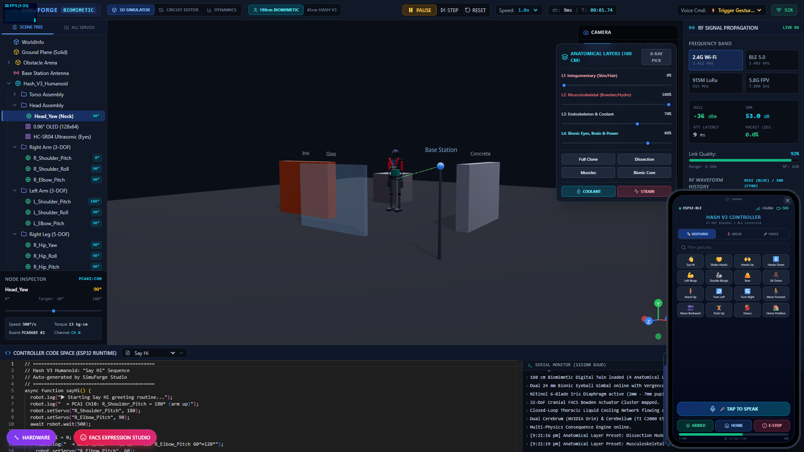 |
| **04** | **Bionic Core: 24 mm Eyeballs, Orin AI Brain & 16S Pack**<br>Deep internal chassis inspection showing the dual 24 mm hollow eyeball assemblies, thoracic NVIDIA Jetson Orin/Thor compute stack, and pelvic 16S Li-ion battery pack. | 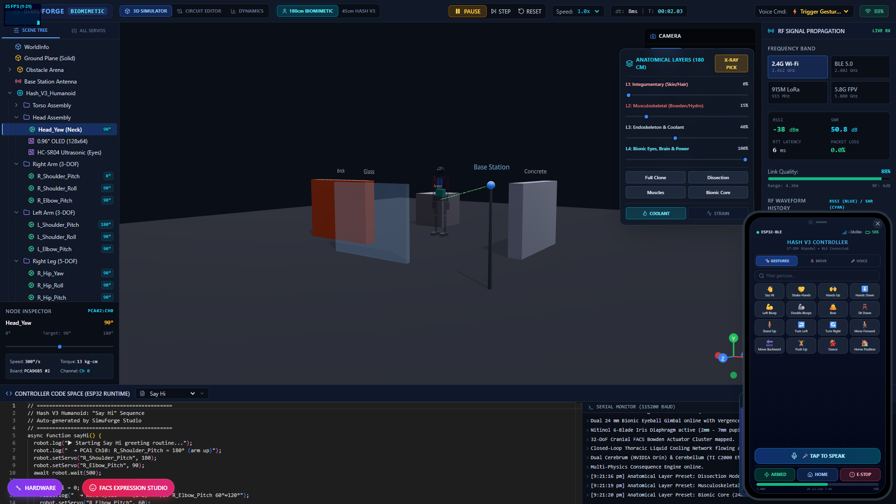 |
| **05** | **FACS Facial Expression Studio**<br>Facial Action Coding System modal with 32 Action Unit sliders (AU1–AU26), real-time dermal strain gauge, and Audio2Face phoneme lip-sync engine. |  |
| **06** | **Audio2Face Smile & Dynamic Lip-Sync**<br>Duchenne smile preset ($AU12=0.95$) combined with phoneme "A" ($AU25=0.8, AU26=0.6$), showing organic mouth opening, skin wrinkling, and live cable tension telemetry. | 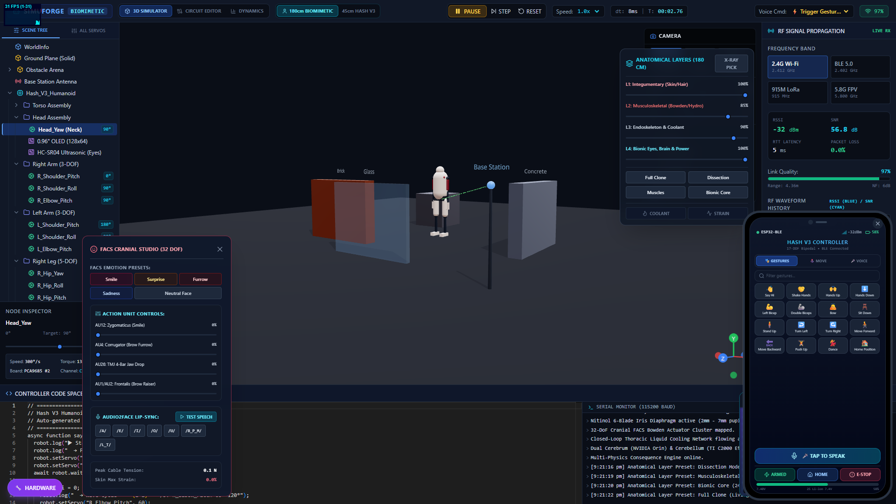 |
| **07** | **Robot Eye View (PiP) Synthetic Sensor Viewport**<br>Floating view looking out through the 24 mm Nitinol iris pupil. Simulates optical exposure gain, depth-of-field blur, rolling vs global shutter skew, and depth point clouds. |  |
| **08** | **Cranial Micro-Zoom & 24 mm Bionic Eyeball Mechanics**<br>Sub-millimeter camera zoom with `logarithmicDepthBuffer: true` (0.5 mm near plane) showcasing the cornea dome, 6-blade Nitinol iris, gold lens barrel, and 8×8 mm MIPI PCB. | 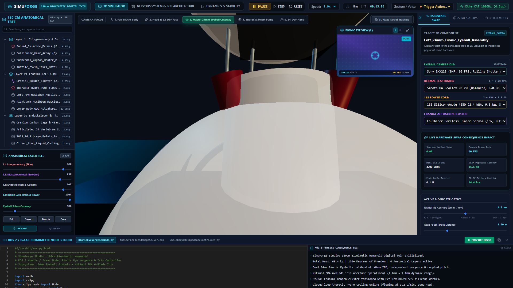 |
| **09** | **MuJoCo / Drake Quality Dynamics Analyzer Panel**<br>Multi-physics dynamics panel with circular stability margin gauge, 2D Graham-scan support polygon ($XZ$), 3D CoM/ZMP trajectories, and 6-DOF IMU specific force telemetry. | 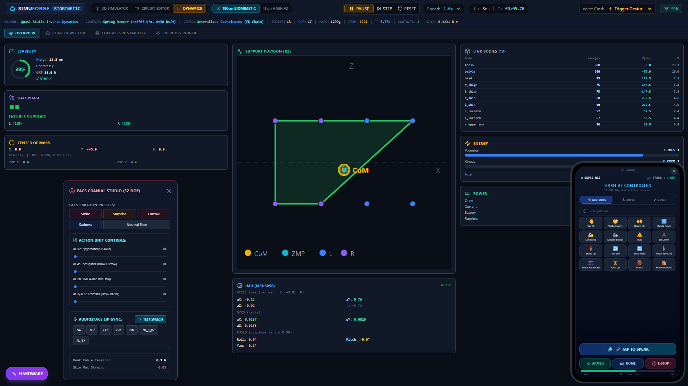 |
| **10** | **Photorealistic Interactive Circuit & Wiring Workbench**<br>Interactive schematic workbench with ESP32 DevKit, dual PCA9685 drivers, OLED monitor, I2C/I2S buses, power distribution UBEC, and C++ firmware code inspector. | 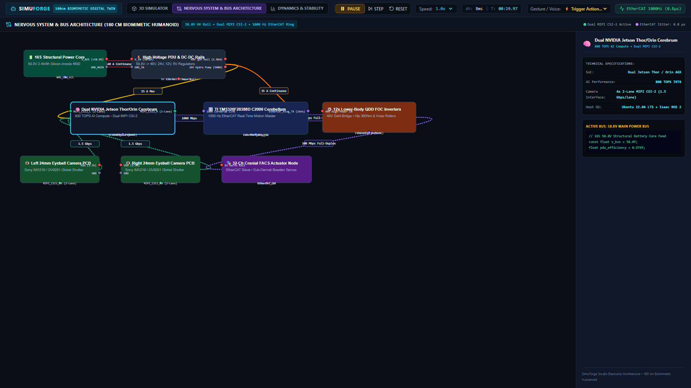 |

---

## 🚀 Quickstart & Local Development

### Prerequisites
- [Node.js](https://nodejs.org/) v18+ 
- [pnpm](https://pnpm.io/) or `npm`

### Installation
```bash
# Clone the repository
git clone https://github.com/rupac4530-creator/simuforge-studio.git
cd simuforge-studio

# Install dependencies
npm install

# Start local development server
npm run dev
```

### Production Build
```bash
npm run build
```

---

## 👥 Authors & Acknowledgments

- **Lead Architect & Engineer**: [Bedanta Chatterjee](https://github.com/rupac4530-creator)
- **Email**: rupac4530@gmail.com
- **Hugging Face**: [@Bedanta12](https://huggingface.co/Bedanta12)
- **GitHub**: [@rupac4530-creator](https://github.com/rupac4530-creator)

Inspired by foundational research from Google DeepMind (*MuJoCo*), Robot Locomotion Group (*Drake*), Cyberbotics (*Webots*), Open Robotics (*Gazebo*), JSK University of Tokyo (*Kengoro*), Engineered Arts (*Ameca*), Hanson Robotics (*Sophia*), and Disney Research.

---

## 📜 License
Distributed under the **MIT License**. See `LICENSE` for details.
