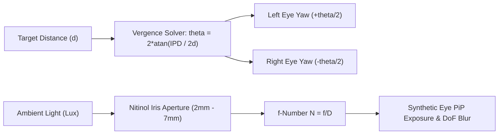

# 180 cm Biomimetic Humanoid Digital Twin: Comprehensive Engineering Blueprint & Multi-Physics Architecture

**Project:** SimuForge Studio — Biomimetic Humanoid Edition (180 cm Full-Clone Architecture)  
**System Class:** 180 cm Adult Anthropomorphic Digital Twin & Live Modular Engineering Simulator  
**Reference Platforms:** Engineered Arts *Ameca*, Hanson Robotics *Sophia*, University of Tokyo *Kengoro / Kenshiro*, Disney Research Animatronics, Tesla *Optimus Gen 2*, Figure AI *Figure 02*, Unitree *H1 / G1*, Boston Dynamics *Atlas*.

---

## 1. State of the Art: Comparative Robotics Analysis

The global robotics landscape has diverged into two high-performance paradigms: **Dynamic Bipedal Workhorses** (focused on locomotion, payload, and industrial task execution) and **High-Fidelity Biomimetic Androids** (focused on social presence, micro-facial expressivity, human skin emulation, and gaze-conformal optics). A true 180 cm "Human Clone" simulator must fuse both paradigms into a unified multi-physics architecture.

```mermaid
graph TD
    A["180 cm Biomimetic Humanoid"] --> B["Cranial & Facial Subsystem"]
    A --> C["Musculoskeletal Subsystem"]
    A --> D["Endoskeleton & Thermal Vascularity"]
    A --> E["Bionic Eyeball & Ocular Optics"]
    A --> F["Compute, Power & Real-Time Bus"]

    B --> B1["32-DoF FACS Bowden Cable Rig"]
    B --> B2["Translucent Silicone Dermis (Ecoflex / Frubber)"]
    B --> B3["Sub-Dermal Tactile Taxel & Heating Grid"]

    C --> C1["McKibben Pneumatic/Hydraulic Hydro-Muscles"]
    C --> C2["24-DoF Tendon-Driven Anthropomorphic Hand"]
    C --> C3["High-Torque Lower-Body QDD & Roller Screws"]

    D --> D1["7075-T6 CNC Aluminum & Carbon Skeleton"]
    D --> D2["Articulated 24-Vertebrae Biomechanical Spine"]
    D --> D3["Closed-Loop Deionized Liquid Cooling Capillaries"]

    E --> E1["24 mm Hollow Spherical Eyeball Assembly"]
    E --> E2["6-DoF Dual-Eye Gimbal with Vergence & Eyelid-Gaze"]
    E --> E3["6-Blade Nitinol Iris (2mm-7mm) + 8x8mm MIPI Sensor"]

    F --> F1["Cerebrum: NVIDIA Jetson Thor/Orin Dual AI Stack"]
    F --> F2["Cerebellum: TI C2000 EtherCAT Real-Time Nodes"]
    F --> F3["16S Li-Ion Power Core (1.8 - 2.4 kWh)"]
```



### 1.1 Comparative Benchmark of Leading Humanoid Projects

| Robot System | Height / Weight | Facial DoF & Dermis | Actuation Architecture | Vision & Gaze | Primary Strength | Simulator Engineering Takeaway |
| :--- | :--- | :--- | :--- | :--- | :--- | :--- |
| **Engineered Arts Ameca** | 187 cm / 72 kg | 27 cranial DoF; proprietary grey silicone; motorized lips/brows | High-precision coreless electric linear & rotary actuators; Bowden neck | Binocular stereoscopic cameras in 24mm eyeballs; independent vergence | Most realistic organic micro-expressions in existence | Decouple cranial motors into clavicle/torso; route via PTFE-sheathed Bowden cables |
| **Hanson Robotics Sophia** | ~168 cm / 45 kg (bust/base) | 36+ cranial DoF; patented porous **Frubber** elastomer | Sub-micro servomotors pulling skin via anchor pegs | Eye cameras behind pupil apertures; face detection & eye tracking | Ultra-low skin stiffness; natural wrinkle generation with minimal torque | Frubber porous matrix drastically reduces servo stall compared to dense silicones |
| **JSK Kengoro / Kenshiro (Tokyo Univ.)** | 167 cm / 54 kg | Skeletal dummy head; zero facial actuation | **116 McKibben artificial muscle actuators**; redundant tendon routing | Stereo vision in head; IMU spine balance | True biological muscle layout; aluminum porous skeleton sweated water to cool | Musculoskeletal hydro-muscles provide biological compliance and shock absorption |
| **Disney Research Animatronics** | 175 cm / 65 kg | 19 facial DoF; multi-layer soft silicone with embedded skin anchors | Hybrid pneumatic-electric actuation with custom 4-bar linkages | High-speed gaze saccades (up to 400°/s) with eyelid-gaze coordination | Uncanny biological eye saccades, breathing chest movements, and blinking | Must simulate saccade motion blur vs global shutter in camera sensors |
| **Tesla Optimus Gen 2** | 173 cm / 57 kg | Screen visor (no expressive face); monolithic aesthetic | Custom planetary QDD (up to 180 Nm) + linear roller-screw actuators | Monocular/stereo RGB + pure vision Occupancy Network | Class-leading bipedal locomotion, mass efficiency, and tactile hands | High-efficiency 52V/48V power distribution and custom structural castings |
| **Figure AI Figure 02** | 178 cm / 70 kg | Face visor; integrated audio array | Custom rotary QDD + linear actuators; 16-DoF hands | 6 onboard RGB cameras, vision-language-action (VLA) AI | End-to-end dexterous manipulation and warehouse logistics | Integrated compute routing; cable-free limb bus architecture |

---

## 2. Multi-Scale 4-Layer Concentric Anatomical Architecture

To allow seamless zoom from the 1.8-meter whole body down to sub-millimeter internal eyeball components, the 3D scene is structured into **4 Concentric Anatomical Layers** with independent opacity sliders ($0.0 \rightarrow 1.0$) and raycast-filtering priorities:

```
[Layer 1: Integumentary / Silicone Dermis]  --> Opacity 0.0 to 1.0 (SSS PBR, Hair, Taxels)
       │
[Layer 2: Musculoskeletal / Actuators]      --> Opacity 0.0 to 1.0 (Hydro-Muscles, Bowden FACS, QDD)
       │
[Layer 3: Endoskeleton / Vascularity]       --> Opacity 0.0 to 1.0 (Carbon/7075-T6 Bones, Cooling Capillaries)
       │
[Layer 4: Bionic Eyeballs, Compute & Core]  --> Opacity 0.0 to 1.0 (24mm Eyes, Iris, MIPI PCB, Orin Brain, 16S Pack)
```

### Layer 1: Integumentary & Dermal System (Outer Surface)
- **Silicone Dermis Mesh**: Anatomical 3D human head, neck, hands, and torso surface with Subsurface Scattering (SSS). Material formulation simulates platinum-cure silicone (`Smooth-On Ecoflex 00-10 / 00-20` or Hanson `Frubber`).
- **Follicular Hair System**: Instanced 3D hair follicles for eyebrows, eyelashes, and hairline punched at physiological angles ($15^\circ$–$45^\circ$).
- **Sub-Dermal Tactile & Heating Matrix**: High-density resistive e-Skin array (1 mm taxel resolution on fingertips, 8 mm on palms, 15 mm on torso/cheeks) maintaining $32^\circ\text{C}$–$36^\circ\text{C}$ surface warmth.

### Layer 2: Musculoskeletal & Actuation System
- **Cranial FACS Rig (32 Degrees of Freedom)**:
  - 32 visible Bowden cable paths originating in the clavicle/cervical servo cluster and anchoring into sub-dermal facial nodes.
  - Standardized Action Units (AUs): AU1 (Inner Brow Raiser), AU2 (Outer Brow Raiser), AU4 (Brow Lowerer), AU5 (Upper Lid Raiser), AU6 (Cheek Raiser), AU9 (Nose Wrinkler), AU12 (Zygomaticus Major / Duchenne Smile), AU15 (Depressor Anguli Oris), AU25 (Lips Part), AU26 (Jaw Drop), AU45 (Blink).
- **Upper-Body Biomimetic Hydro-Muscles**: McKibben braided artificial hydro-muscles driving shoulder complex, biceps, triceps, and a 24-DoF anthropomorphic tendon hand. Powered by a 500W thoracic micro-hydraulic pump.
- **Lower-Body High-Torque QDD Actuators**: Frameless Permanent Magnet Synchronous Motors (PMSM) with 6:1 / 8:1 planetary stages at hips and ankles (up to 180–360 Nm peak), combined with inverted planetary roller-screw linear actuators in thighs and calves (up to 8,000 N axial force).

### Layer 3: Endoskeleton & Thermal Vascularity
- **Skeletal Structure (180 cm)**: CNC 7075-T6 anodized aluminum load-bearing core wrapped in carbon-fiber structural shells.
- **Biomechanical Spine**: 24-vertebrae articulated column with elastomeric damping discs providing 3-DoF thoracic flexion/extension, lateral bending, and axial twisting.
- **Closed-Loop Liquid Cooling Network**: Micro-capillary fluid conduits routing deionized water + 15% propylene glycol from the thoracic compute bay and hip motors up through sub-dermal heat exchangers and nasal/oral radiator exhausts.

### Layer 4: Micro-Electronics, Ocular Optics & Power Core
- **The 24 mm Bionic Eyeball Assemblies (Left & Right Independent)**:
  - Human anatomical eyeball diameter: **24.0 mm**.
  - Mounted on a 6-DoF Dual-Eye Gimbal providing:
    - **Independent Left/Right Yaw** ($\pm 35^\circ$) for binocular stereoscopic vergence (crossing eyes when focusing on near objects $< 0.5\text{ m}$).
    - **Coupled Pitch** ($\pm 30^\circ$) for vertical gaze elevation.
    - **Independent Upper & Lower Eyelids** ($\pm 45^\circ$) with automatic lid-gaze pitch coordination.
  - **Nested Eyeball Internals**:
    1. `Cornea_Lens_Dome`: 12 mm radius refractive acrylic dome with index of refraction $n = 1.376$.
    2. `Sclera_Housing`: 24 mm veined ivory sphere with iris aperture hole.
    3. `Iris_Diaphragm_Mechanism`: Actuated 6-blade Nitinol Shape Memory Alloy (SMA) iris dynamically adjusting pupil aperture between **2.0 mm** (bright light, high depth of field) and **7.0 mm** (low light, shallow depth of field).
    4. `Internal_Camera_Sensor_PCB`: 8×8 mm micro-camera PCB mounted directly behind the pupil with optical lens barrel and rear flexible MIPI CSI-2 ribbon cable.
- **Thoracic Dual-Brain & Battery Core**:
  - `Cerebrum`: Dual NVIDIA Jetson AGX Orin / Thor AI modules running VLA models, vision SLAM, audio phoneme synthesis, and emotional state machines.
  - `Cerebellum`: TI TMS320F28388D C2000 32-bit real-time microcontrollers operating 1 kHz EtherCAT and CAN-FD motor control loops.
  - `Battery Core`: 16S 58.8V nominal NMC 21700 or Silicon-Anode 4680 cell pack (1.8–2.4 kWh).

---

## 3. Mathematical Foundations & Multi-Physics Consequence Models

### 3.1 Ocular Optics, Pupil Dilation & Sensor Response

The effective focal ratio ($f$-number) $N$ of the eyeball optical assembly is governed by focal length $f$ and pupil aperture diameter $D$:
$$N = \frac{f}{D}$$
where $D \in [2.0\text{ mm}, 7.0\text{ mm}]$.

The exposure illuminance $E_v$ reaching the 8×8 mm CMOS die scales inversely with $N^2$:
$$E_v \propto \frac{1}{N^2} = \left(\frac{D}{f}\right)^2$$
Dilating the pupil from 2 mm to 7 mm increases light throughput by a factor of:
$$\left(\frac{7.0}{2.0}\right)^2 = 12.25\times \quad (+3.61\text{ EV})$$

**Depth of Field ($DoF$)**:
$$DoF \approx \frac{2 u^2 N c}{f^2}$$
where $u$ is object distance and $c$ is the circle of confusion. Widening the pupil to 7 mm produces physiological foreground/background optical blur.

**Stereo Vergence Angle ($\theta_v$)**:
Given an inter-pupillary distance ($IPD$) of **64 mm** (0.064 m) and a target distance $d_{\text{target}}$:
$$\theta_{\text{vergence}} = 2 \arctan\left(\frac{IPD / 2}{d_{\text{target}}}\right) = 2 \arctan\left(\frac{0.032}{d_{\text{target}}}\right)$$
When a target approaches to $0.20\text{ m}$ in front of the face, the eyes verge inward by $18.18^\circ$.



### 3.2 Silicone Elasticity, Facial Wrinkling & Servo Stall

The force $F_{\text{cable}}$ required to pull a silicone facial anchor node across strain $\epsilon = \frac{\Delta L}{L_0}$ is modeled via non-linear hyperelastic Ogden / Mooney-Rivlin continuum mechanics, approximated for small-to-moderate deformations as:
$$F_{\text{cable}} = E_{\text{silicone}} \cdot A_{\text{cross}} \cdot \epsilon + \mu \frac{d\epsilon}{dt}$$
where:
- $E_{\text{silicone}}$ is the Young's Modulus of the dermal elastomer:
  - `Smooth-On Ecoflex 00-10`: $E = 0.05\text{ MPa}$
  - `Smooth-On Ecoflex 00-20`: $E = 0.08\text{ MPa}$
  - `Nanoporous Frubber`: $E = 0.03\text{ MPa}$
  - `Smooth-On Dragon Skin 10`: $E = 0.59\text{ MPa}$ ($11.8\times$ stiffer!)

The torque required at the cranial servo pulley of radius $r_{\text{pulley}} = 6\text{ mm}$ is:
$$\tau_{\text{servo}} = F_{\text{cable}} \cdot r_{\text{pulley}}$$

If $\tau_{\text{servo}} > \tau_{\text{stall}}$, the servo enters stall condition:
- The facial mesh deformation stalls ($\Delta L_{\text{actual}} < \Delta L_{\text{target}}$).
- Electrical current spikes to stall limit ($I_{\text{stall}} \approx 1.8\text{ A}$ per servo).
- A mechanical strain heatmap renders red around the affected facial anchor.

### 3.3 Cranial & Thoracic Thermal Cascade

Because silicone skin acts as a high-efficiency thermal insulator ($k_{\text{silicone}} \approx 0.15\text{ W/(m}\cdot\text{K)}$), internal components cannot dissipate heat through radiation or natural convection alone.

Total internal thermal generation:
$$P_{\text{heat}} = P_{\text{compute}} + \sum_{i=1}^{32} P_{\text{cranial\_servos}, i} + \sum_{j=1}^{12} P_{\text{body\_motors}, j} + P_{\text{pump}}$$

The core equilibrium temperature $T_{\text{core}}$ is solved dynamically:
$$C_{\text{thermal}} \frac{dT_{\text{core}}}{dt} = P_{\text{heat}} - \dot{Q}_{\text{coolant}} - \dot{Q}_{\text{breath\_exhaust}} - \dot{Q}_{\text{skin\_loss}}$$
where coolant convective heat removal is:
$$\dot{Q}_{\text{coolant}} = \dot{m} \cdot c_p \cdot (T_{\text{out}} - T_{\text{in}})$$
If liquid coolant flow rate $\dot{m}$ falls below the thermal threshold, skull temperature exceeds $45^\circ\text{C}$, triggering an automatic thermal throttle alert and increasing nasal exhaust fan RPM.

---

## 4. Hardware Component Registry & Consequence Matrix

Every component in SimuForge Studio binds to the `ComponentRegistry`, enabling real-time hot-swapping and immediate multi-physics consequence recalculation:

| Subsystem | Swappable Component | Manufacturer / Specs | Power / Bandwidth | Mechanical / Physical Impact | Optical / Visual Impact |
| :--- | :--- | :--- | :--- | :--- | :--- |
| **Eyeball Camera** | **Sony IMX219 (8MP)** | Sony; 3280×2464; 60 FPS; Rolling Shutter; 77° FOV | 180 mW; 1.5 Gbps MIPI CSI-2 | Weight: 3.2g; fits 24mm eye | High-res RGB; visible rolling shutter skew during fast saccades |
| **Eyeball Camera** | **OmniVision OV9281 (1MP)** | OmniVision; 1280×800; 120 FPS; **Global Shutter**; 110° FOV | 140 mW; 0.8 Gbps MIPI CSI-2 | Weight: 2.8g; fits 24mm eye | Crisp monochrome; **zero motion blur**; ultra-fast SLAM tracking |
| **Eyeball Camera** | **OmniVision OV5640 (5MP)** | OmniVision; 2592×1944; 90 FPS; Voice-Coil Auto-Focus; 68° FOV | 220 mW; 1.2 Gbps MIPI CSI-2 | Weight: 4.1g; micro lens barrel | Vivid color; lens breathing during auto-focus transitions |
| **Eyeball Camera** | **Prophesee Gen4.1 Neuromorphic** | Prophesee; 1280×720; 10,000+ FPS equiv; 120 dB dynamic range | 50 mW; Asynchronous Event Stream | Weight: 3.6g; neuromorphic die | Asynchronous temporal contrast stream; microsecond low-latency tracking |
| **Dermal Silicone** | **Smooth-On Ecoflex 00-10** | Smooth-On; Shore 00-10; Modulus 0.05 MPa; elongation 800% | Passive; $k = 0.15\text{ W/m}\cdot\text{K}$ | Ultra-soft; minimal servo torque; moderate tear resistance | Translucent human SSS; natural fine skin folds |
| **Dermal Silicone** | **Smooth-On Ecoflex 00-20** | Smooth-On; Shore 00-20; Modulus 0.08 MPa; elongation 700% | Passive; $k = 0.16\text{ W/m}\cdot\text{K}$ | Balanced compliance; high tear resistance; standard facial skin | Crisp facial wrinkles; requires 60% more servo torque |
| **Dermal Silicone** | **Nanoporous Frubber** | Hanson Robotics; porous elastomer; Modulus 0.03 MPa | Passive; density 0.35 g/cm³ | **40% lower servo load**; hyper-elastic micro-porous structure | Micro-wrinkle fidelity; authentic human smile lines |
| **Dermal Silicone** | **Smooth-On Dragon Skin 10** | Smooth-On; Shore 10A; Modulus 0.59 MPa ($11.8\times$ stiffer) | Passive; dense silicone | Extremely high stiffness; **triggers cranial servo stall warnings** | Severe resistance to facial smiles; rigid mask-like appearance |
| **Cranial Actuators** | **Coreless Linear Micro-Servos** | Faulhaber 0615 + micro lead screw; 15N force; 0.02mm res | 0.8W peak; 5V rail | Silent operation; ultra-high precision; zero backlash | Seamless continuous mouth and brow articulation |
| **Upper Body Actuation**| **McKibben Hydro-Muscles** | Custom Festo DMSP hydro-pneumatic; 800N pull; 25% contraction | 500W micro-pump; 3.5 L/min | Biological elasticity; natural compliance; high shock absorption | Lifelike arm/shoulder muscle contraction contours |
| **Lower Body Actuation**| **RoboDrive ILM QDD + Roller Screw** | RoboDrive PMSM + 8:1 planetary; 180-360 Nm peak | 48V bus; up to 1.8 kW burst | High-bandwidth ground contact impedance; dynamic jumping/balancing | Agile 180 cm humanoid bipedal gait |
| **Battery Core** | **16S NMC 21700 Pack (1.8 kWh)** | Samsung 50G; 58.8V nom; 30Ah; 11.2 kg | 1.76 kWh; max 90A burst | Low center of mass in lower pelvis; 3.5 hr runtime | Statically stable; shifts CoM downward |
| **Battery Core** | **16S Silicon-Anode 4680 (2.4 kWh)** | Amprius / Tesla 4680; 60V; 40Ah; 9.8 kg | 2.40 kWh; max 140A burst | 1.4 kg lighter; 36% more capacity; 5.2 hr runtime | Higher agility; wider walking stability margin |

---

## 5. Architectural Upgrade Roadmap for SimuForge Studio

To implement this full-scale upgrade into SimuForge Studio cleanly and robustly:

1. **State & Types Migration (`src/types/biomimetic.ts`)**:
   - Define multi-layer state (`integumentary`, `musculoskeletal`, `endoskeletal`, `electronics`).
   - Define 32-channel FACS Action Units and Audio2Face phoneme registers.
   - Define eyeball gimbal optics, camera models, and consequence metrics.

2. **Hardware Database (`src/engine/ComponentRegistry.ts`)**:
   - Complete executable database of 20+ real-world sensors, silicones, motors, compute modules, and battery arrays with exact mathematical formulas.

3. **Multi-Physics Consequence Solver (`src/engine/BiomimeticConsequenceEngine.ts`)**:
   - Optical Ray & Exposure Model (FOV, DoF blur, iris dilation, rolling vs. global shutter).
   - Facial Kinematics & Skin Stress Solver (Ogden elasticity, cable tensions, servo stall alerts).
   - Electrical, Bandwidth & Thermal Cascade (MIPI lane saturation, bus currents, skull/torso heat equilibrium).
   - Whole-Body 180 cm Dynamics & CoM Solver.

4. **180 cm Procedural 3D Biomimetic Assembly (`src/components/BiomimeticHumanoidModel.tsx`)**:
   - Layer 1: Translucent silicone dermis with SSS, eyebrow/eyelash hair, taxel overlay.
   - Layer 2: 32 cranial Bowden cables, upper-body McKibben hydro-muscles, lower-body QDDs.
   - Layer 3: CNC 7075-T6 aluminum skeleton, 24-vertebrae spine, liquid cooling capillaries.
   - Layer 4: Left & right 24 mm hollow bionic eyeballs with rotating gimbal, 6-blade iris, 8×8 mm MIPI PCB camera, thoracic Orin brain, and 16S battery pack.

5. **User Interface & Interactive Controls**:
   - `LayerControlBar.tsx`: 4 anatomical opacity sliders + X-Ray Dissection Mode + visual overlay toggles.
   - `LiveModuleEditorPanel.tsx`: Click-to-inspect part drawer with live hot-swap selector and parameter sliders.
   - `RobotEyePiPViewport.tsx`: Floating synthetic eye viewport looking through the 24mm pupil with real-time camera consequence simulation.
   - `FacialExpressionStudio.tsx`: FACS Action Unit slider mixer + Audio2Face phoneme sequencer with live strain and stall telemetry.
